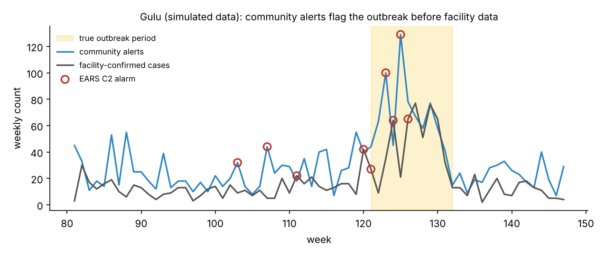
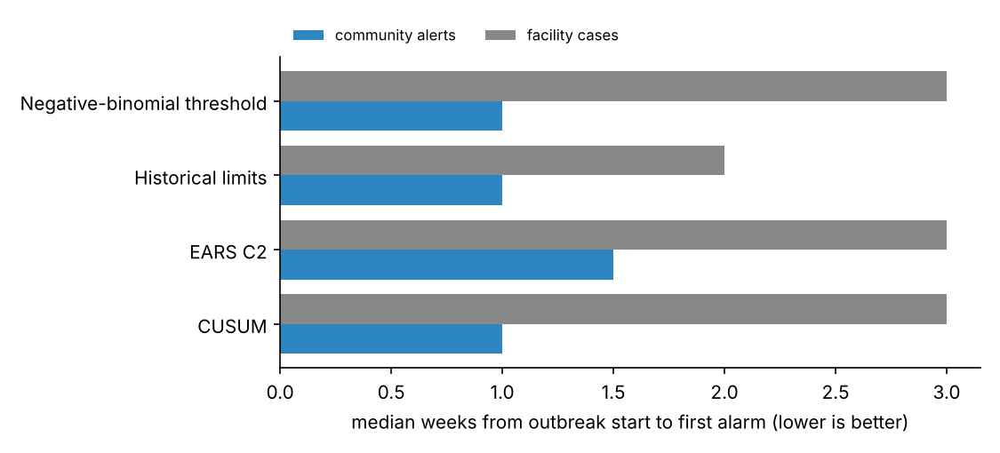

# OutbreakAnalytics

**Can community health-worker alerts give earlier warning of outbreaks than facility-reported cases?**

Uganda's community health system (eCHIS) lets village health workers report suspected cases directly from the community, while facility data (HMIS/IDSR) arrive after care-seeking, testing and weekly reporting. This repository compares the two streams as early-warning signals, using four standard aberration-detection algorithms on simulated weekly district data with known outbreaks.

It accompanies ongoing work on outbreak and epidemic surveillance in Uganda's National Health Data Warehouse.

> **All data are simulated.** Districts carry real Ugandan names (e.g. Kasese, Hoima, Arua) to make the setting concrete, but every count and every outbreak is generated by the code — none describes a real event. No Ministry of Health, eCHIS or patient data are included.



## Results

40 Ugandan districts (simulated counts) × 208 weeks, 15 simulated outbreaks. Scored on weeks after a two-year history.

| Stream | Algorithm | Sensitivity | Median weeks to detect | False alarms / district-year |
|:--|:--|--:|--:|--:|
| Community alerts | EARS C2 | 0.93 | 1.5 | 1.77 |
| Community alerts | Historical limits | 1.00 | 1.0 | 3.10 |
| Community alerts | CUSUM | 1.00 | 1.0 | 1.34 |
| Community alerts | Negative-binomial threshold | 0.93 | 1.0 | 0.63 |
| Facility cases | EARS C2 | 1.00 | 3.0 | 1.77 |
| Facility cases | Historical limits | 1.00 | 2.0 | 3.50 |
| Facility cases | CUSUM | 1.00 | 3.0 | 1.65 |
| Facility cases | Negative-binomial threshold | 1.00 | 3.0 | 0.66 |



**What this shows**

1. **Community alerts detected outbreaks 1–2 weeks earlier** than facility data with every algorithm. With EARS C2, the community stream was first in 11 of the 14 outbreaks detected by both streams.
2. **Earlier is not free.** Community data are noisier, so a few outbreaks are missed and some algorithms raise more false alarms. The negative-binomial threshold gave the best balance (fewer than one false alarm per district per year).
3. **The two streams are complementary.** Facility data confirm what community alerts suggest; a practical system could trigger investigation from community signals and use facility data to verify.

These conclusions hold *for the simulation's assumptions* (a two-week facility reporting delay, noisier community counts). Testing them on real eCHIS and IDSR data is the next step.

## Quick start

```bash
pip install -r requirements.txt
python run_analysis.py   # writes results/
pytest -q                # 4 tests
```

## Method

- **Simulation** (`outbreak/simulate.py`): each district (labelled with a real Ugandan district name) has a simulated seasonal baseline with negative-binomial noise. Half the districts get one outbreak (6–13 weeks) after a two-year history. Community alerts see the excess immediately (with extra noise); facility cases see it after a reporting delay.
- **Algorithms** (`outbreak/detect.py`), each using only data available up to the week being tested:
  - **EARS C2** (CDC) — compares each week to a 7-week baseline ending 2 weeks earlier
  - **Historical limits** — compares to the same weeks in the previous two years
  - **CUSUM** — accumulates standardised excess over time
  - **Negative-binomial threshold** — a simplified Farrington-style seasonal threshold
- **Evaluation** (`outbreak/evaluate.py`): sensitivity (share of outbreaks detected), median weeks from outbreak start to first alarm, false alarms per district-year outside outbreaks, and per-outbreak lead time of community over facility detection.

## Limitations and next steps

- Real outbreaks vary in shape, and community reporting varies by district and over time; both need testing on real data under data-sharing approval.
- Data-quality problems (late, missing or duplicated reports) affect alarms. Combining these algorithms with data-quality checks — see [health-data-quality-checks](https://github.com/moseskizito/health-data-quality-checks) and [routine-data-anomaly-detection](https://github.com/moseskizito/routine-data-anomaly-detection) — would separate true outbreaks from reporting errors.
- Spatial methods (alarms clustering in neighbouring districts) are not yet included.

## License

MIT © Moses Kizito
